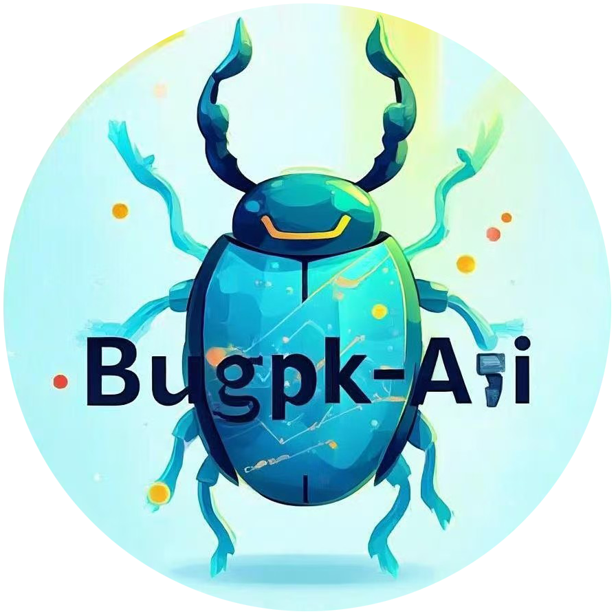

<div align="center">
  
  <h1>短视频去水印解析接口 · EdgeOne Makers 版</h1>
  <p><em>多平台短视频解析 · 免 Cookie · 无水印直链 · 边缘函数部署</em></p>
</div>

---

## 🎯 项目简介

本项目是 [jiuhunwl/short_videos](https://github.com/jiuhunwl/short_videos)（PHP 版短视频去水印解析接口）的 **EdgeOne Makers 改造版**：

- 原 PHP 接口全部移植为 **EdgeOne 边缘函数**（`edge-functions/` 目录，文件即路由），部署在腾讯 EdgeOne 全球 3200+ 边缘节点上
- 抖音解析复用项目自带的 Cloudflare Workers 版逻辑（与边缘函数运行时语法兼容），其余平台由 PHP 逐一移植为 JavaScript
- `api/sv.php` 聚合入口从「HTTP 自转发」改为「模块 import 直接调用」，省去一次回环请求
- `wyy.py`（Python/Flask 版网易云解析）移植为边缘函数（AES-128 + MD5 以纯 JS 实现，兼容 Web Crypto 运行时）
- 新增静态首页（`public/`）：平台列表、接口文档、在线解析测试

> ⚠️ 原项目重要声明继续适用：本项目仅用于学习交流与技术测试，解析素材的版权归原平台及权利人所有，不得用于任何非法用途。

## 📂 项目结构

```
short_videos-edgeone/
├── public/                        # 静态站点（Makers 构建输出目录）
│   ├── index.html                 #   首页：平台列表 + 在线测试 + 接口文档
│   └── img/                       #   图片资源（来自原项目）
├── edge-functions/                # 边缘函数（文件即路由）
│   └── api/
│       ├── sv.js                  #   聚合解析 /api/sv
│       ├── douyin.js              #   抖音 /api/douyin（视频/图集/实况，原画直链）
│       ├── douyin/home.js         #   抖音主页批量 /api/douyin/home（需 Cookie）
│       ├── kuaishou.js            #   快手 /api/kuaishou
│       ├── xiaohongshu.js         #   小红书 /api/xiaohongshu
│       ├── bilibili.js            #   哔哩哔哩 /api/bilibili（?ver=old 走旧版）
│       ├── weibo.js               #   微博·接口版 /api/weibo
│       ├── weibo_v.js             #   微博·爬虫版 /api/weibo_v
│       ├── toutiao.js             #   今日头条 /api/toutiao
│       ├── ppxia.js               #   皮皮虾 /api/ppxia
│       ├── pipigx.js              #   皮皮搞笑 /api/pipigx
│       ├── zuiyou.js              #   最右 /api/zuiyou
│       ├── wyy.js                 #   网易云音乐 /api/wyy（原 Python 版）
│       ├── doubao/video.js        #   豆包 AI 视频 /api/doubao/video
│       ├── doubao/duihua.js       #   豆包对话分享 /api/doubao/duihua
│       ├── jimengai.js            #   即梦 AI 视频 /api/jimengai
│       ├── proxy.js               #   媒体防盗链代理 /api/proxy
│       └── PORTING_CONVENTIONS.md #   移植统一约定（内部文档）
├── docs/                          # 原 JSON 格式文档
├── package.json
└── README.md
```

## 🔐 三平台登录入口（前端已内置）

首页「在线测试」板块内提供 B站 / 微博 / 网易云 登录入口：

- **B站**：扫码登录、账号密码登录、短信登录三种方式。密码/短信登录会触发 geetest 滑块
  风控，**验证码由用户在前端手动完成挑战**（geetest gt.js 官方组件，弹出滑块由用户拖动），
  完成后携带 validate/seccode 提交登录。密码经服务端 RSA PKCS1v1.5（纯 JS 实现）加密
  md5(password) 后提交，密码不落盘。
- **微博**：扫码登录（passport sso v2）、账号密码登录（经典 sina SSO：prelogin →
  RSA PKCS1v1.5 加密 `servertime\tnonce\n密码`（hex 模数，纯 JS BigInt 实现）→ login.php →
  遍历 crossDomainUrlList 收集 SUB/SUBP 等完整 Cookie）。
- **网易云**：扫码登录（eapi unikey）、手机号密码登录 / 邮箱密码登录、短信验证码登录
  （weapi 加密：双层 AES-128-CBC + 裸 RSA，纯 JS 实现，见 `wyy/login/weapi.js`）。
  注意网易云对陌生 IP 有 `-460 风控` 可能，部署后如遇风控请优先使用扫码登录。

所有登录 Cookie **仅保存在用户自己的浏览器 localStorage**，解析请求时通过
`x-bili-cookie` / `x-weibo-cookie` / `x-wyy-cookie` 请求头随请求转发，边缘函数不做任何
存储。**未登录或 Cookie 失效时自动使用免登录版本解析，互不影响**（B站链路免 Cookie 已
实测可用；登录后画质/可用性提升取决于各平台对对应账号的策略）。

## 📖 接口速查

所有接口统一返回 `{code, msg, data}` JSON，入参支持 `GET ?url=` 或 `POST`（form/JSON body 的 `url` 字段），支持整段分享文本，开放 CORS。

| 路由 | 对应原 PHP 接口 |
|------|----------------|
| `/api/sv?url=` | `api/sv.php` |
| `/api/douyin?url=` | `api/douyin/douyin.php` |
| `/api/douyin/home?url=` | `api/douyin-home/home.php` |
| `/api/kuaishou?url=` | `api/kuaishou/ksjx.php` |
| `/api/xiaohongshu?url=` | `api/xiaohongshu/xhsjx.php` |
| `/api/bilibili?url=` | `api/bilibili/bilibili.php`（`&ver=old` 旧版；支持 `x-bili-cookie` 请求头或 `?cookie=` 参数携带登录 Cookie 提升画质） |
| `/api/bilibili/login/qr` | **新增**：B站扫码登录·生成二维码（返回 `qrcode_key` + `qr_url`） |
| `/api/bilibili/login/poll?qrcode_key=` | **新增**：B站扫码登录·轮询状态（成功返回 `cookie`/`cookie_map`，status: waiting/scanned/confirmed/expired） |
| `/api/bilibili/login/captcha` | **新增**：B站登录·获取 geetest 验证码参数（`token`/`gt`/`challenge`，滑块由用户手动完成） |
| `/api/bilibili/login/password` | **新增**：B站账号密码登录（服务端 RSA PKCS1v1.5 加密 md5(password)，需先完成 geetest 挑战） |
| `/api/bilibili/login/sms/send` | **新增**：B站短信登录·发送验证码（需先完成 geetest 挑战，返回 `grecaptcha_token`） |
| `/api/bilibili/login/sms/confirm` | **新增**：B站短信登录·验证码确认登录 |
| `/api/weibo/login/qr` · `/api/weibo/login/poll?qrid=` | **新增**：微博扫码登录（passport sso v2，成功换取 SUB/SUBP 等 Cookie） |
| `/api/weibo/login/password` | **新增**：微博账号密码登录（经典 sina SSO 流程，RSA 加密密码，成功返回完整 Cookie） |
| `/api/wyy/login/qr` · `/api/wyy/login/poll?key=` | **新增**：网易云扫码登录（eapi unikey，成功换取 MUSIC_U/__csrf Cookie） |
| `/api/wyy/login/password` | **新增**：网易云手机号/邮箱密码登录（weapi 加密） |
| `/api/wyy/login/sms/send` · `/api/wyy/login/sms/confirm` | **新增**：网易云短信验证码发送与登录（weapi 加密） |
| `/api/weibo?url=` | `api/weibo.php`（支持 `x-weibo-cookie` 请求头 / `?weibo_cookie=` 参数携带登录 Cookie） |
| `/api/weibo_v?url=` | `api/weibo_v.php` |
| `/api/toutiao?url=` | `api/toutiao.php` |
| `/api/ppxia?url=` | `api/ppxia.php` |
| `/api/pipigx?url=` | `api/pipigx.php` |
| `/api/zuiyou?url=` | `api/zuiyou.php` |
| `/api/wyy?url=` | `api/wyy.py`（支持 `x-wyy-cookie` 请求头 / `?wyy_cookie=` 参数携带登录 Cookie） |
| `/api/doubao/video?url=` | `api/doubao/video/api.php` |
| `/api/doubao/duihua?url=` | `api/doubao/duihua/duihua.php` |
| `/api/jimengai?url=` | `api/jimengai/index.php` |
| `/api/proxy?proxyurl=` | `cf_sv_proxy/worker.js`（原 `api/svproxyurl.php`） |

> 视频直链 403 防盗链时，用 `/api/proxy?proxyurl=<直链>` 代理转发，支持 `type=douyin|weibo`、`download=true` 等参数，行为与原 `cf_sv_proxy` 一致。

字段说明详见 `docs/视频解析统一JSON格式3.0.md`。

## 📄 许可证

MIT License（见 [LICENSE](LICENSE)），原项目版权归 [JH-Ahua](https://github.com/jiuhunwl/short_videos) 所有。

## 📝 备注：环境变量

以下环境变量为可选配置（在 EdgeOne Makers 控制台的环境变量设置中填写）：

| 变量 | 必需 | 说明 |
|------|:---:|------|
| `DOUYIN_HOME_COOKIE` | 仅 /api/douyin/home 需要 | 抖音登录 Cookie，用于主页批量解析；其余接口均免 Cookie |
| `BILI_COOKIE` | 可选 | B站全局默认 Cookie（服务端兜底），仅当请求未携带用户自己的 Cookie 时使用 |
| `WEIBO_COOKIE` | 可选 | 微博全局默认 Cookie（兜底），用户请求未携带 `x-weibo-cookie` 时使用 |
| `WYY_COOKIE` | 可选 | 网易云全局默认 Cookie（兜底），用户请求未携带 `x-wyy-cookie` 时使用 |
